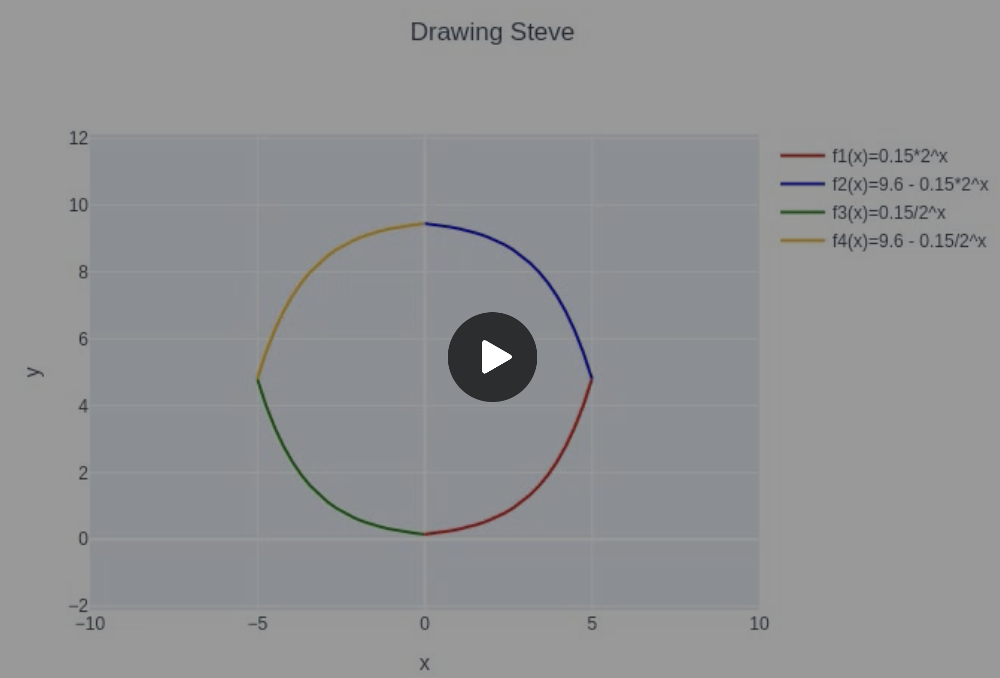

# Proyectos de la cara

Aquí están los proyectos de la cara que hicieron los estudiantes, sin información que los identifique.

En el proyecto, los estudiantes usan figuras cerradas para diseñar una cara. 
La función madre es una exponencial de la forma: $\quad f1(x) = a \cdot b^{(x-c)} + d.$ 

A partir de la función madre $\quad f1(x)$, definida con:
>`make_closed_fig(plot, a=0.15, b=2, h=0, k=0, d=0, num_of_points=10)`

se genera una figura cerrada como la que se muestra aquí (esta imagen es fija y no tiene video; vean los ejemplos de video más abajo):

  

Fíjense que `make_closed_fig()` generó las funciones $\quad f2(x), f3(x), f4(x)$. 

Usando la función `make_closed_fig()` una y otra vez, los estudiantes crearon los proyectos de video de abajo. 

**En los siguientes ejemplos, hagan clic en reproducir para ver los videos.**
**El código está debajo de cada ejemplo.**

[Clase 1, grupo 2](https://github.com/user-attachments/assets/36a98c7f-c002-46e6-88d9-83f7de39f257)

[Cuaderno completo de Google Colab para ejecutar el código (en inglés)](https://github.com/pattichis/GraphFuns2/blob/main/Graphfuns_Face_Project_C1_G2.ipynb) 
[PDF impreso de la parte del código que hicieron los estudiantes](https://github.com/pattichis/GraphFuns2/blob/main/Projects/Graphfuns_Face_Project_C1_G2.pdf) 

## Clase 1, grupo 3
[Clase 1, grupo 3](https://github.com/user-attachments/assets/c7887901-706b-49a8-a747-848ad110f5d9)

## Clase 2, grupo 1
[Clase 2, grupo 1](https://github.com/user-attachments/assets/fc89ac98-fd27-4d57-ab9d-0ea82523809f)

## Clase 2, grupo 2
[Clase 2, grupo 2](https://github.com/user-attachments/assets/116214db-4319-4315-80d7-391904c34ae1)

## Clase 2, grupo 3
[Clase 2, grupo 3](https://github.com/user-attachments/assets/81ed910f-61cd-4d4b-9780-19600775c727)

## Clase 2, grupo 4
[Clase 2, grupo 4](https://github.com/user-attachments/assets/db769bff-ef6a-4d87-89b1-4d396f253204)

## Clase 3, grupo 1
[Clase 3, grupo 1](https://github.com/user-attachments/assets/8b5230fc-e062-4632-a92e-15807f23f0c9)

## Clase 3, grupo 2
[Clase 3, grupo 2](https://github.com/user-attachments/assets/d9bfc70e-c03f-470b-97da-8c1258b354dc)

## Clase 3, grupo 3
[Clase 3, grupo 3](https://github.com/user-attachments/assets/85cbe3b2-e85c-40eb-9481-a6494718c329)

## Clase 3, grupo 4
[Clase 3, grupo 4](https://github.com/user-attachments/assets/c6e29ea3-6f88-471e-89dd-4cd6853aad76)
