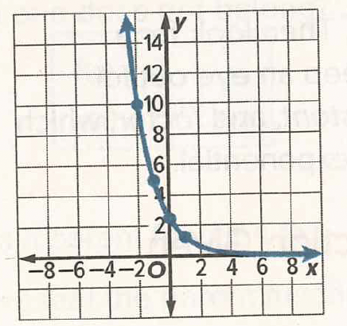

# Lección 9-3: Escribir funciones exponenciales
Construye funciones exponenciales $y = a b ^x$: 
* a partir de dos puntos.
* a partir de una gráfica.
* a partir de una descripción.

## 9-3.1. Verificar la gráfica a partir de dos puntos (del ejemplo 1 de la sección 9-3 del libro).
Considera la función exponencial de la gráfica que
pasa por $(1, 6)$ y $(3, 24)$.

Verifica tu respuesta con `Graficar cualquier función` de [Homework_funs](https://colab.research.google.com/github/pattichis/GraphFuns2/blob/main/Homework_funs_es.ipynb).

## 9-3.2. Crear una gráfica exponencial a partir de una función (del ejemplo 2 de la sección 9-3 del libro).
Considera la siguiente gráfica del libro de texto: 

 

Deduce una expresión de la forma &nbsp; $y = a b^x$. 
Verifica la expresión para $x = -2, -1, 0, 1.$ 

Verifica que tu gráfica dé los mismos resultados usando
`Graficar cualquier función` de [Homework_funs](https://colab.research.google.com/github/pattichis/GraphFuns2/blob/main/Homework_funs_es.ipynb).

## 9-3.3. Decaimiento exponencial (del ejemplo 6 de la sección 9-3 del libro)
Para el decaimiento exponencial, tenemos: 
$\qquad y = a (1-r)^t$. 
donde: 
$\qquad y$ &nbsp; es la cantidad final. 
$\qquad a$ &nbsp; es la cantidad inicial. 
$\qquad t$ &nbsp; representa el tiempo. 
$\qquad r$ &nbsp; representa la tasa de decaimiento expresada como decimal: &nbsp; $0< r < 1$. 

Ahora presentamos un problema que usa el decaimiento exponencial. 

En los bancos, una cuenta inactiva es una que no se ha usado en más de un año.
Un banco cobra una cuota mensual del 0.8% del saldo de las cuentas inactivas.
Una cuenta inactiva tenía al principio un saldo de \$1609.

Para este problema, deduce una expresión de la forma: 
$\qquad y = a (1-r)^t$ &nbsp; como se describe arriba. 

Puedes investigar los efectos a lo largo del tiempo usando
`Graficar cualquier función` de [Homework_funs](https://colab.research.google.com/github/pattichis/GraphFuns2/blob/main/Homework_funs_es.ipynb).

Puedes investigar los efectos de distintos porcentajes deduciendo las ecuaciones y luego
usando `Comparar varias funciones en la misma gráfica` para graficar distintas funciones de
[Homework_funs](https://colab.research.google.com/github/pattichis/GraphFuns2/blob/main/Homework_funs_es.ipynb). 
